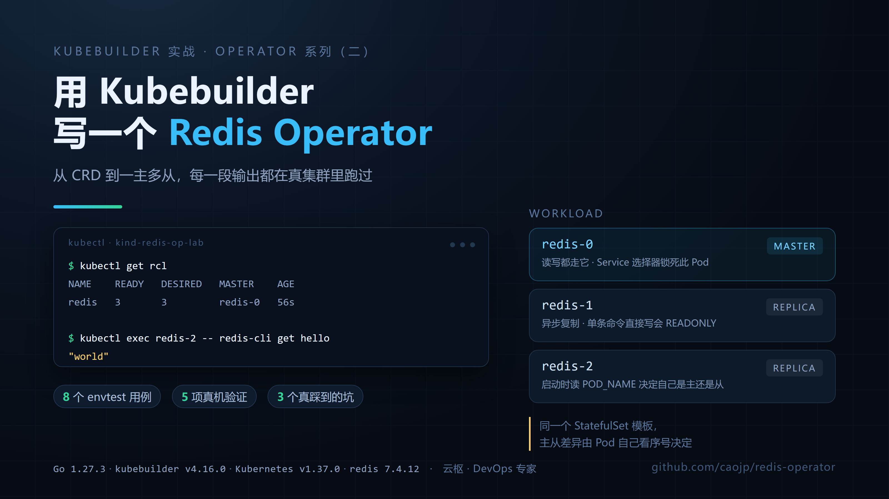

# redis-operator



用 Kubebuilder 从零写的一个 Redis Operator：声明一个 `RedisCluster` 对象，控制器负责拉起一主多从的 Redis、给客户端一个稳定的主节点入口、把运行状态写回 `.status`。

配套文章：<https://www.workbuddy.cn/space/d/DbNyjyHNlhWJR7gHIWBena>（姊妹篇，讲 Operator 原理）与本仓库 README 的完整实现说明。

## 它做什么

```
                 ┌──────────────────────────────┐
  kubectl apply  │  RedisCluster (CR)           │
  ─────────────► │  spec.replicas: 3            │
                 └──────────────┬───────────────┘
                                │ watch
                 ┌──────────────▼───────────────┐
                 │  RedisClusterReconciler      │
                 │  CreateOrUpdate → 幂等       │
                 └───┬──────────┬───────────┬───┘
                     │          │           │
        ┌────────────▼──┐  ┌────▼────────┐  ┌▼──────────────┐
        │ Headless Svc  │  │ StatefulSet │  │ 读写 Service  │
        │ redis-headless│  │ redis-0..N  │  │ selector=     │
        │ DNS: pod-0... │  │ 1 主 N-1 从 │  │ pod-name: -0  │
        └───────────────┘  └─────────────┘  └───────────────┘
```

- **一主多从**：`pod-0` 是主节点，其余从节点通过 `--replicaof redis-0.redis-headless.<ns>.svc.cluster.local 6379` 跟随。
- **稳定读写入口**：`redis` 这个 ClusterIP Service 用 `statefulset.kubernetes.io/pod-name: <name>-0` 精确指向主节点，客户端不用自己维护地址。
- **状态可观测**：控制器用内置的极简 RESP 客户端连到主节点执行 `INFO replication`，把 `connected_slaves` 写进 `.status.connectedReplicas`，并维护 `Available` / `Progressing` / `ReplicationHealthy` 三个标准 Condition。
- **幂等**：所有子资源都走 `controllerutil.CreateOrUpdate`，同一个 CR 被调谐 N 次与 1 次结果一致。

## 已验证版本

下面这些版本是本仓库代码实际编译、跑测试、并在真实集群里跑通过的组合，不是"应该可以"：

| 组件 | 版本 |
| --- | --- |
| Go | go1.27.3 windows/amd64（构建）+ go1.27.3 linux/amd64（测试） |
| kubebuilder | v4.16.0 |
| controller-runtime | v0.25.0 |
| k8s.io/api 等 | v0.37.0 |
| controller-gen | v0.22.0 |
| Kubernetes（实测集群） | v1.37.0（kind v0.33.0） |
| Redis 镜像 | redis:7.4.12 |

`go.mod` 里声明 `go 1.26.0`，所以 Go 1.26 及以上都能编。

## 快速开始

```bash
git clone https://github.com/caojp/redis-operator.git
cd redis-operator

# 1. 装 CRD
make install

# 2. 本地跑控制器（前台，直连当前 kubeconfig）
make run

# 3. 另开一个终端，提交 CR
kubectl apply -f config/samples/cache_v1_rediscluster.yaml
kubectl get rc -w
```

期望看到：

```
NAME    READY   DESIRED   MASTER   AGE
redis   3       3         redis-0  45s
```

验证主从确实生效：

```bash
# 主节点写入
kubectl exec redis-0 -- redis-cli set hello world

# 从节点只读，能看到同一份数据
kubectl exec redis-1 -- redis-cli get hello          # world
kubectl exec redis-1 -- redis-cli info replication | grep -E "role|master_link_status"
```

## CR 字段

| 字段 | 类型 | 默认值 | 说明 |
| --- | --- | --- | --- |
| `spec.replicas` | int32 | `3` | 实例总数，1~6。1 主 + (N-1) 从 |
| `spec.image` | string | `redis:7.4.12` | Redis 镜像 |
| `spec.storage.size` | string | `1Gi` | 每个实例的数据盘容量，匹配 `^[0-9]+(Mi\|Gi\|Ti)$` |
| `spec.storage.className` | string | 集群默认 | StorageClass |
| `spec.resources` | ResourceRequirements | 无 | 容器资源声明 |
| `spec.auth.secretName` | string | 无 | 存放密码的 Secret（同命名空间） |
| `spec.auth.secretKey` | string | `password` | Secret 中的键名 |

不写 `spec.storage` 时数据盘用 `emptyDir`，Pod 重建数据即丢，只适合验证功能。

`status` 里可读的字段：`readyReplicas`、`master`、`connectedReplicas`、`observedGeneration`、`conditions[]`。

## 跑测试

```bash
make test
```

等价于用 envtest 起一个真实 kube-apiserver（不需要 Docker、不需要集群），然后跑：

- `internal/redisinfo`：RESP 客户端与 `INFO replication` 解析，含一个假 Redis 服务端，断网也能跑
- `internal/controller`：创建子资源、幂等、扩缩容、PVC 模板、status 回写、删除后安全返回、CRD 校验拦截非法值

> **Windows 用户注意**：controller-runtime v0.25.0 的 envtest 支撑包在 Windows 上编译不过（`pkg/internal/testing/process` 里 `signalProcess` 重复声明）。测试请在 Linux / WSL / 容器里跑，`go build` 在 Windows 上是正常的。

## 已知限制

这些是刻意留的边界，不是 bug：

1. **没有自动故障切换**。主节点固定为 `pod-0`；`pod-0` 挂掉时 StatefulSet 会把它重建回来，重建期间写入不可用。真正的故障切换要处理主从选举、脑裂和数据丢失窗口，这件事 Redis 生态里已有 Sentinel 和 Cluster 两种成熟方案，自己写一套轮子风险大于收益。
2. **`VolumeClaimTemplates` 创建后不可变**。给已有集群加 `spec.storage` 或改 `size` 不会生效，需要重建 StatefulSet 或手动扩 PVC。
3. **删 CR 不会删数据盘**。StatefulSet 的 `persistentVolumeClaimRetentionPolicy` 默认就是 `Retain`，控制器也显式写成了 `Retain`。重建同名集群会复用这些 PVC，确认不要数据了得自己删：

   ```bash
   kubectl delete pvc -l app.kubernetes.io/instance=redis-prod
   ```

4. **单命名空间内 CR 名称唯一**，子资源名由 CR 名派生（`<name>`、`<name>-headless`），不支持同一命名空间跑两个同名集群。

## 目录

```
api/v1/rediscluster_types.go          CRD 类型与校验标记
internal/controller/                  控制器主体
internal/redisinfo/                   极简 RESP 客户端
config/crd/bases/                     生成的 CRD
config/samples/                       示例 CR
config/rbac/                          生成的 RBAC
cmd/main.go                           Manager 入口
```

## License

Apache-2.0，见 [LICENSE](LICENSE)。
