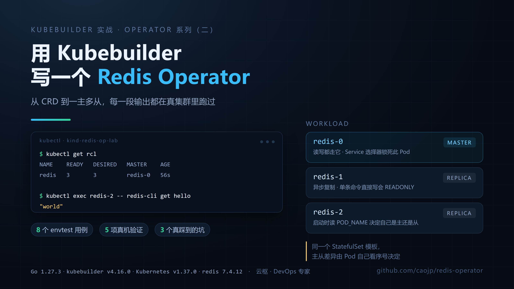
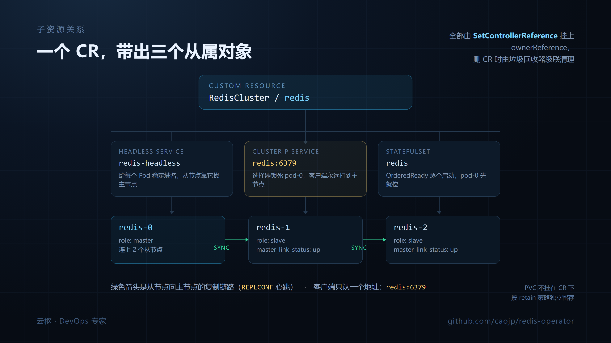
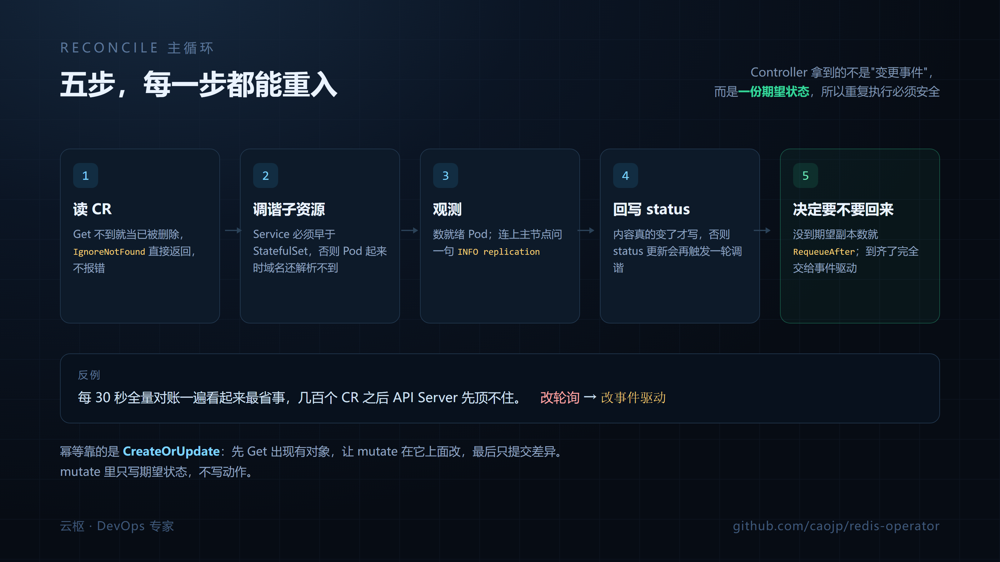

# 用 Kubebuilder 写一个 Redis Operator：从 CRD 到一主多从跑通



上一篇讲完 Operator 的原理，结尾留了个坑：用 Kubebuilder 从零实现一个 Redis Operator。

这篇文章把坑填了。代码全部在 <https://github.com/caojp/redis-operator>，可以直接 clone 下来跑。文中每一段输出都是我在真实集群里跑出来的，不是"预期结果"，版本号写在第二节。

先说清楚它不是什么：这不是一个能在生产顶替 Sentinel 的东西。我在最后一节专门讲了为什么故意不做故障切换，以及真要做得付出什么代价。

## 一、这个 Operator 到底要干几件事

写代码之前得先把边界划出来。我的目标很克制，就四件：

1. 用户写一个 `RedisCluster` 对象，说"我要 3 个实例"，控制器把 1 主 2 从拉起来。
2. 客户端要读写的时候，有一个固定入口指向当前主节点，不用自己查谁是主。
3. 主节点挂掉、Pod 重建之后，从节点能自己重新连回去。
4. `kubectl get rcl` 能看出集群到底好没好，不用进去 `redis-cli` 一个个敲。

第三条其实是 StatefulSet 帮我做的（Pod 名字固定，重建后 DNS 不变），第四条要靠自己写。真正属于 Operator 的活是第一、二、四条。

子资源的形状定成这样：

- `redis-headless`：headless Service，给每个 Pod 一个稳定域名，从节点靠它找主节点。
- `redis`：普通 ClusterIP Service，选择器锁死 `statefulset.kubernetes.io/pod-name: <cr名>-0`，客户端连它永远是主节点。
- `redis`（StatefulSet）：1 主 N-1 从，`pod-0` 是主。



主节点固定成 `pod-0` 是刻意的取舍，原因在最后一节。

## 二、环境和版本

我不想写"理论上兼容"，这张表是我实际编译、跑测试、在集群里验证过的组合：

| 组件 | 版本 | 用途 |
| --- | --- | --- |
| Go | go1.27.3 | 编译和测试 |
| kubebuilder | v4.16.0 | 脚手架 |
| controller-runtime | v0.25.0 | 控制器框架 |
| k8s.io/api | v0.37.0 | 类型定义 |
| controller-gen | v0.22.0 | 生成 deepcopy、CRD、RBAC |
| Kubernetes | v1.37.0（kind v0.33.0） | 实测集群 |
| Docker | 29.7.2 | 构建镜像 |
| Redis 镜像 | redis:7.4.12 | 被管理的实例 |

`go.mod` 里写的是 `go 1.26.0`，所以 Go 1.26 以上都能编，我用的是 1.27.3。

有个坑先提醒：**kubebuilder 的 CLI 不支持 Windows 宿主**。我在 Windows 上直接跑 `kubebuilder init`，它回了一句 `host not supported: windows`，然后什么都没生成。后来是把 Linux 版二进制扔进 `golang:1.27-alpine` 容器里跑的脚手架。Mac 和 Linux 用户不会遇到这个。

还有个更影响测试的坑：**controller-runtime v0.25.0 的 envtest 支撑包在 Windows 上编译不过**，`pkg/internal/testing/process` 里 `signalProcess` 重复声明。也就是说 `go build` 没问题，`go test` 直接编译失败。测试我是在 Linux 容器里跑的。

这两条不是抱怨，是给同样在 Windows 上折腾的人省两个小时。

## 三、脚手架

```bash
mkdir redis-operator && cd redis-operator
kubebuilder init --domain example.com --repo github.com/caojp/redis-operator
kubebuilder create api --group cache --version v1 --kind RedisCluster --resource --controller
```

生成的骨架长这样（v4 布局）：

```
redis-operator/
├── cmd/main.go                        # Manager 入口
├── api/v1/rediscluster_types.go       # 写 Spec / Status
├── internal/controller/
│   └── rediscluster_controller.go     # 写 Reconcile
├── config/                            # CRD、RBAC、Manager 清单
├── test/                              # e2e 骨架
└── Makefile
```

`--repo` 必须显式给，否则在非 GOPATH 目录下会报错。这条官方文档里提了，但很容易漏。

`create api` 会自动跑一次 `make generate`，如果环境里没有 `make`，它会报一个 `exec: "make": executable file not found`，然后停下。资源文件其实已经生成了，补跑一次生成就行：

```bash
controller-gen object:headerFile="hack/boilerplate.go.txt" paths="./api/v1"
controller-gen rbac:roleName=manager-role crd webhook \
  paths="./api/v1;./internal/controller" output:crd:artifacts:config=config/crd/bases
```

注意 `paths` 的写法。在 Windows 的 Git Bash 里，`paths="./..."` 会被 controller-gen 当成"当前目录"，然后抱怨 `no Go files in D:\work\redis-operator`。用显式包路径加引号最稳。

## 四、CRD 类型：把校验交给 API Server

`api/v1/rediscluster_types.go` 的 Spec：

```go
type RedisClusterSpec struct {
	// Replicas 是 Redis 实例总数，其中 1 个主节点，其余为从节点。
	// +kubebuilder:validation:Minimum=1
	// +kubebuilder:validation:Maximum=6
	// +kubebuilder:default=3
	// +optional
	Replicas int32 `json:"replicas,omitempty"`

	// Image 是 Redis 容器镜像，建议固定到具体版本，避免隐式升级。
	// +kubebuilder:default="redis:7.4.12"
	// +optional
	Image string `json:"image,omitempty"`

	// +optional
	Resources corev1.ResourceRequirements `json:"resources,omitempty"`

	// +optional
	Storage *StorageSpec `json:"storage,omitempty"`

	// +optional
	Auth *AuthSpec `json:"auth,omitempty"`
}
```

这些 `+kubebuilder:` 标记不是注释装饰，`make manifests` 会把它们变成 CRD 的 OpenAPI schema，用户在 `kubectl apply` 那一刻就被拦下，不用等控制器跑起来才报错。

存储和认证拆成子结构：

```go
type StorageSpec struct {
	// +kubebuilder:default="1Gi"
	// +kubebuilder:validation:Pattern=`^[0-9]+(Mi|Gi|Ti)$`
	// +optional
	Size string `json:"size,omitempty"`

	// +optional
	ClassName *string `json:"className,omitempty"`
}

type AuthSpec struct {
	// +kubebuilder:validation:MinLength=1
	SecretName string `json:"secretName"`

	// +kubebuilder:default="password"
	// +optional
	SecretKey string `json:"secretKey,omitempty"`
}
```

密码只放 Secret 引用，CR 里不出现明文。这条没什么可商量的。

Status 部分，我按 K8s 的惯例用 `metav1.Condition`：

```go
type RedisClusterStatus struct {
	// +optional
	ObservedGeneration int64 `json:"observedGeneration,omitempty"`

	// +optional
	ReadyReplicas int32 `json:"readyReplicas"`

	// +optional
	Master string `json:"master,omitempty"`

	// +optional
	ConnectedReplicas int32 `json:"connectedReplicas"`

	// +listType=map
	// +listMapKey=type
	// +optional
	Conditions []metav1.Condition `json:"conditions,omitempty"`
}
```

`ConnectedReplicas` 这个字段我特意没抄 StatefulSet 的数字，而是让控制器真的连上主节点问一句 `INFO replication`，把回答填进去。区别在哪：StatefulSet 说 3 个 Pod Ready，不代表从节点真的挂上主节点了。这两个数字对不上的时候，就是排障的入口。

对象上还挂了几个打印列，`kubectl get` 直接能看：

```go
// +kubebuilder:resource:shortName=rcl
// +kubebuilder:printcolumn:name="Ready",type=integer,JSONPath=`.status.readyReplicas`
// +kubebuilder:printcolumn:name="Desired",type=integer,JSONPath=`.spec.replicas`
// +kubebuilder:printcolumn:name="Master",type=string,JSONPath=`.status.master`
// +kubebuilder:printcolumn:name="Age",type=date,JSONPath=`.metadata.creationTimestamp`
```

短名我最开始写的是 `rc`。`kubectl get rc` 会跟内置的 ReplicationController 撞名，先甩一句 `Warning: short name "rc" could also match lower priority resource`，然后去查 ReplicationController，回你一个 `No resources found`——而我的 CR 明明就在那儿。改成 `rcl` 之后正常。

### 一个反直觉的坑：`omitempty` 吃掉了 0

我写测试的时候想验证"replicas 小于 1 会被 CRD 拦住"，于是用 Go 结构体造了个 `Replicas: 0` 的 CR 提交上去，结果没报错，创建成功了。

原因是 `Replicas int32` 带了 `omitempty`：Go 序列化时把 0 当成空值省略，请求体里压根没有 `replicas` 字段，API Server 一看字段缺失，就把默认值 3 填了进去。

所以这类"提交非法值应该被拒"的测试，得用非结构化对象，让 0 原样送到 API Server：

```go
newRaw := func(name string, spec map[string]interface{}) *unstructured.Unstructured {
	return &unstructured.Unstructured{Object: map[string]interface{}{
		"apiVersion": "cache.example.com/v1",
		"kind":       "RedisCluster",
		"metadata":   map[string]interface{}{"name": name, "namespace": testNamespace},
		"spec":       spec,
	}}
}

err := k8sClient.Create(ctx, newRaw("cache-invalid", map[string]interface{}{"replicas": int64(0)}))
Expect(apierrors.IsInvalid(err)).To(BeTrue())
```

这个坑值得记一笔：测 Go 客户端的序列化，和测 CRD 的校验，是两件事。

## 五、Reconcile：五步，每步都能重入



控制器的入口就这一段：

```go
func (r *RedisClusterReconciler) Reconcile(ctx context.Context, req ctrl.Request) (ctrl.Result, error) {
	log := logf.FromContext(ctx)

	// 1. 读 CR。读不到通常意味着已被删除，直接结束即可。
	var rc cachev1.RedisCluster
	if err := r.Get(ctx, req.NamespacedName, &rc); err != nil {
		return ctrl.Result{}, client.IgnoreNotFound(err)
	}

	// 2. 逐个调谐子资源。顺序有意义：Service 先于 Pod 存在，
	//    StatefulSet 拉起 Pod 时才能解析到自己的稳定域名。
	if err := r.reconcileHeadlessService(ctx, &rc); err != nil {
		return ctrl.Result{}, err
	}
	if err := r.reconcileMasterService(ctx, &rc); err != nil {
		return ctrl.Result{}, err
	}
	sts, err := r.reconcileStatefulSet(ctx, &rc)
	if err != nil {
		return ctrl.Result{}, err
	}

	// 3. 观测：就绪 Pod 数、主节点连了几个从节点。
	observed, err := r.observe(ctx, &rc)
	if err != nil {
		return ctrl.Result{}, err
	}

	// 4. 回写 status。只有内容真的变了才写，避免自我触发的无限循环。
	if err := r.updateStatus(ctx, &rc, observed); err != nil {
		return ctrl.Result{}, err
	}

	// 5. 没到期望副本数就主动回来再看一眼；到齐了就完全交给事件驱动。
	if observed.ReadyReplicas < rc.Spec.Replicas || sts.Status.ReadyReplicas < rc.Spec.Replicas {
		log.V(1).Info("集群尚未就绪，稍后再查", "ready", observed.ReadyReplicas, "desired", rc.Spec.Replicas)
		return ctrl.Result{RequeueAfter: requeueInterval}, nil
	}
	return ctrl.Result{}, nil
}
```

`RequeueAfter` 只在没就绪时用。集群一切正常的话，控制器就靠事件驱动，不会定时去戳 API Server。这点很重要：很多新手 Operator 图省事写成每 30 秒全量对账一遍，几百个 CR 之后 API Server 就顶不住了。

三个子资源的调谐都走同一个套路：

```go
op, err := controllerutil.CreateOrUpdate(ctx, r.Client, sts, func() error {
	r.mutateStatefulSet(rc, sts)
	return controllerutil.SetControllerReference(rc, sts, r.Scheme)
})
```

`CreateOrUpdate` 帮你做了三件事：先 Get，让 mutate 函数在"已有对象"上改，然后用 merge patch 提交差异。等于把"查—比对—改"这套动作封装了。幂等靠的就是它：mutate 里只写期望状态，不写动作。

`SetControllerReference` 设置 ownerReference，删 CR 的时候 K8s 的垃圾回收器会把 Service、StatefulSet 一起带走。这一行忘了写，删完 CR 会留下一堆孤儿资源，而且 owner 为空的对象 kubectl 看起来一切正常，等你 re-apply 同名 CR 才发现冲突。

## 六、主从是"长"出来的，不是配出来的

难点在于：一个 StatefulSet 里所有 Pod 用的是同一个模板，但主节点和从节点的启动参数不一样。解法是让 Pod 自己看序号：

```sh
set -eu
ORDINAL="${HOSTNAME##*-}"
FLAGS="--port 6379 --dir /data --protected-mode no --appendonly yes --replica-announce-ip ${POD_IP:-127.0.0.1}"
if [ -n "${REDIS_PASSWORD:-}" ]; then
  FLAGS="$FLAGS --requirepass ${REDIS_PASSWORD} --masterauth ${REDIS_PASSWORD}"
fi
if [ "${ORDINAL}" = "0" ]; then
  echo "[entrypoint] 以主节点身份启动"
  exec redis-server $FLAGS
fi
echo "[entrypoint] 以从节点身份启动，跟随 ${MASTER_HOST}:6379"
exec redis-server $FLAGS --replicaof "${MASTER_HOST}" 6379
```

`HOSTNAME` 在 StatefulSet 里就是 Pod 名（`redis-0`、`redis-1`），`${HOSTNAME##*-}` 取最后一段就是序号。这段脚本作为容器的 `args` 传给 `/bin/sh -c`，只用一个模板就分出两种角色。

两个环境变量一个是 `POD_IP`（从 `status.podIP` 注入，`replica-announce-ip` 靠它，否则主节点 `INFO replication` 里看到的从节点地址是容器内部地址），一个是 `MASTER_HOST`，值是主节点的稳定域名：

```
redis-0.redis-headless.default.svc.cluster.local
```

这个域名能解析，前提是 headless Service 存在且 `publishNotReadyAddresses: true`：

```go
svc.Spec.ClusterIP = corev1.ClusterIPNone
svc.Spec.Selector = selectorLabels(rc)
// 未就绪也发布 DNS 记录，否则从节点启动时解析不到主节点。
svc.Spec.PublishNotReadyAddresses = true
```

默认 `publishNotReadyAddresses` 是 false，也就是 Pod 没 Ready 就不发 DNS 记录。但这里有个死锁：从节点要连上主节点才能 Ready，而 Pod 的 Ready 探针 `redis-cli ping` 跟复制没关系……本来到这里也能过，可一旦主节点自己也还在启动，从节点解析不到域名就会一直重试。打开这个开关，Pod 一 Running 就有 DNS，省掉一堆启动期的抖动。

读写入口是另一个 Service，选择器里加一个 K8s 自动维护的标签：

```go
svc.Spec.Selector = withPodName(selectorLabels(rc), masterPodName(rc))
// → app.kubernetes.io/name: redis
//   app.kubernetes.io/instance: redis
//   statefulset.kubernetes.io/pod-name: redis-0
```

`statefulset.kubernetes.io/pod-name` 是 StatefulSet 控制器给每个 Pod 打的标签，不用自己维护。把 Service 的选择器锁到这个标签上，客户端连 `redis:6379` 就永远落在主节点，主从关系变化时也不需要改任何配置。

## 七、status 的数据从哪来

`readyReplicas` 好办，数 Pod 就行。但"从节点真的挂上主节点了吗"这个问题，只有 Redis 自己知道。

我没有引入 `go-redis`。这个依赖很重，而我只需要问一个问题：主节点现在连着几个从节点。于是写了个 60 行的 RESP 客户端，只用标准库：

```go
func Fetch(ctx context.Context, addr, password string, timeout time.Duration) (*Replication, error) {
	dialer := net.Dialer{Timeout: timeout}
	conn, err := dialer.DialContext(ctx, "tcp", addr)
	if err != nil {
		return nil, fmt.Errorf("连接 %s 失败: %w", addr, err)
	}
	defer func() { _ = conn.Close() }()

	if err := conn.SetDeadline(time.Now().Add(timeout)); err != nil {
		return nil, err
	}

	rd := bufio.NewReader(conn)
	if password != "" {
		if _, err := roundTrip(conn, rd, "AUTH", password); err != nil {
			return nil, fmt.Errorf("AUTH 失败: %w", err)
		}
	}

	info, err := roundTrip(conn, rd, "INFO", "replication")
	if err != nil {
		return nil, fmt.Errorf("读取 INFO replication 失败: %w", err)
	}
	return Parse(info)
}
```

协议本身很简单，发出去的是一个数组，每个元素是"长度 + 内容"：

```go
func roundTrip(conn net.Conn, rd *bufio.Reader, args ...string) (string, error) {
	var sb strings.Builder
	fmt.Fprintf(&sb, "*%d\r\n", len(args))
	for _, a := range args {
		fmt.Fprintf(&sb, "$%d\r\n%s\r\n", len(a), a)
	}
	if _, err := conn.Write([]byte(sb.String())); err != nil {
		return "", err
	}
	return readReply(rd)
}
```

回包只处理四种前缀就够用：`+` 简单字符串、`-` 错误、`:` 整数、`$` 批量字符串。`$` 后面跟长度，读到 `-1` 是 nil。

解析出来的结构：

```go
type Replication struct {
	Role            string // master / slave
	ConnectedSlaves int32
	MasterHost      string
	MasterPort      int32
	LinkStatus      string // up / down
}
```

控制器在 `observe()` 里用它，注意这里的错误处理：

```go
connected, redisErr := r.connectedReplicas(ctx, rc, pods)
if redisErr != nil {
	status.ConnectedReplicas = 0
	meta.SetStatusCondition(&status.Conditions, metav1.Condition{
		Type:    "ReplicationHealthy",
		Status:  metav1.ConditionUnknown,
		Reason:  "MasterUnreachable",
		Message: redisErr.Error(),
	})
}
```

连不上 Redis 不算 Reconcile 的错误。集群刚创建时主节点还没起来，连不上完全正常；如果这里返回 error，控制器会指数退避重试，日志里全是红字，而实际上什么都没坏。正确做法是把"读不到"记成 `Unknown` 条件，让 Reconcile 继续走下去。

三个 Condition 的分工：

- `Available`：Pod 全 Ready。
- `ReplicationHealthy`：主节点报的 `connected_slaves` 等于 `replicas - 1`。
- `Progressing`：还有活没干完（Pod 没齐，或者从节点没连上）。

`Available=True` 但 `ReplicationHealthy=False`，说明 Pod 都活着但复制链路断了。这个组合是最值得配告警的状态，光看 Pod Ready 是发现不了的。

## 八、踩坑：控制器每 10 秒写一次 StatefulSet

跑起来之后我看了下日志，发现这个：

```
INFO  StatefulSet 已同步  {"statefulset": "redis-prod", "operation": "updated"}
DEBUG 集群尚未就绪，稍后再查 {"ready": 2, "desired": 3}
INFO  StatefulSet 已同步  {"statefulset": "redis-prod", "operation": "updated"}
DEBUG 集群尚未就绪，稍后再查 {"ready": 2, "desired": 3}
```

每隔 10 秒一次 `updated`，而实际上没有任何 spec 变化。

原因在 `CreateOrUpdate` 的实现：它比较的是"读到手的对象"和"mutate 之后的内部对象"。我是这么写的：

```go
sts.Spec.Template.Spec.Containers = []corev1.Container{r.redisContainer(rc)}
```

整块替换容器列表。问题是 API Server 会往容器里补默认值，`terminationMessagePath: /dev/termination-log`、`terminationMessagePolicy: File`，`env[].valueFrom.fieldRef.apiVersion: v1` 这些我从来没写过。整体替换之后，merge patch 的意图变成"把这些字段删掉"，API Server 收到又补回来，下一轮再比，还是不一样。本地算出来的 diff 永远不为空。

（顺带说一句，这个行为在 envtest 里不一定测得出来。merge patch 删掉默认值，API Server 又补回来，对象内容可能压根没变，`resourceVersion` 也不一定动。我是翻日志发现的，不是测试报出来的。）

修法是只改自己负责的字段，剩下的原样保留：

```go
func (r *RedisClusterReconciler) mergeRedisContainer(rc *cachev1.RedisCluster, podSpec *corev1.PodSpec) {
	desired := r.redisContainer(rc)

	if len(podSpec.Containers) != 1 || podSpec.Containers[0].Name != desired.Name {
		podSpec.Containers = []corev1.Container{desired}
		return
	}

	target := &podSpec.Containers[0]
	target.Image = desired.Image
	target.ImagePullPolicy = desired.ImagePullPolicy
	target.Command = desired.Command
	target.Args = desired.Args
	target.Ports = desired.Ports
	target.Env = desired.Env
	target.Resources = desired.Resources
	target.VolumeMounts = desired.VolumeMounts
	target.ReadinessProbe = desired.ReadinessProbe
	target.LivenessProbe = desired.LivenessProbe
	target.SecurityContext = desired.SecurityContext
}
```

同时把那个会被补默认值的地方显式写死：

```go
FieldRef: &corev1.ObjectFieldSelector{
	APIVersion: "v1",          // API Server 本来就会补这个，写上省得每轮都比出差异
	FieldPath:  "status.podIP",
},
```

改完重启，日志里 `updated` 归零。

这个坑的通用教训是：写 Reconcile 的时候得在脑子里分清哪些字段是我拥有的、哪些是别人填的。前者可以覆盖，后者碰了就打架。字段一多，手动 merge 会很烦，那时候再考虑 Server-Side Apply（`kubebuilder create api` 带了 `--ssa` 参数），用 field ownership 让 API Server 自己算归属。

## 九、测试：envtest 里不需要集群

`make test` 用的是 envtest，它会在本地起一个真的 `kube-apiserver` 和 `etcd`，但没有 kubelet、没有调度器。对控制器逻辑来说这就够了，比 fake client 真实得多。fake client 不走 CRD 校验，也不做默认填充。

8 个用例覆盖这些：

| 用例 | 断言的东西 |
| --- | --- |
| 按 CR 创建子资源 | headless 是 `None`、读写 Service 选择器指向 `-0`、image 用了 CRD 默认值 |
| 重复调谐不改对象 | 连跑 4 次，StatefulSet 的 `resourceVersion` 不变 |
| 保留 API Server 默认字段 | 手动写入 `terminationMessagePath`，再调谐一次还在 |
| 改 replicas 同步 | 3 → 5，StatefulSet 跟着变 |
| 配 storage 生成 PVC 模板 | `2Gi`、`storageClassName` 正确、不挂 emptyDir |
| 按 Ready Pod 回写 status | `readyReplicas`、`master`、`Available=True`、`ReplicationHealthy=Unknown` |
| 删 CR 后调谐返回 nil | 不 panic、不报错 |
| CRD 校验拦非法值 | `replicas: 0`、`replicas: 9`、`storage.size: 1G` 全被拒 |

RESP 客户端那部分不依赖任何外部服务，测试里自己起了个假 Redis：

```go
func startFakeRedis(t *testing.T, password, info string) (addr string, stop func()) {
	t.Helper()
	ln, err := net.Listen("tcp", "127.0.0.1:0")
	if err != nil {
		t.Fatalf("监听失败: %v", err)
	}
	go func() {
		for {
			conn, err := ln.Accept()
			if err != nil {
				return
			}
			go handleFakeConn(conn, password, info)
		}
	}()
	return ln.Addr().String(), func() { _ = ln.Close() }
}
```

它认得 `AUTH` 和 `INFO`，密码错了回 `-WRONGPASS`。这样断网也能跑，CI 里不用起 Redis 容器。

### envtest 的二进制不好下

`make test` 会先跑 `setup-envtest use <version>` 下载 `kube-apiserver` 和 `etcd`。我这台机器上这一步挂了：

```
unable to list versions to find latest one: unable to perform request to get index:
Get "https://raw.githubusercontent.com/kubernetes-sigs/controller-tools/HEAD/envtest-releases.yaml": EOF
```

索引文件在 `raw.githubusercontent.com` 上，`storage.googleapis.com/kubebuilder-tools` 那条老路径也已经 403 了。如果你也卡在这，可以绕一下：`kube-apiserver` 和 `etcd` 在官方镜像里都有，抠出来就是 envtest 要的东西。

```bash
# 1.37.0 对应 k8s.io/api v0.37.0
docker create --name apiserver k8s.m.daocloud.io/kube-apiserver:v1.37.0
docker cp apiserver:/usr/local/bin/kube-apiserver bin/k8s/1.37.0-linux-amd64/kube-apiserver
docker rm apiserver

docker create --name etcd k8s.m.daocloud.io/etcd:3.7.0-0
docker cp etcd:/usr/local/bin/etcd bin/k8s/1.37.0-linux-amd64/etcd
docker rm etcd

chmod +x bin/k8s/1.37.0-linux-amd64/*
KUBEBUILDER_ASSETS=bin/k8s/1.37.0-linux-amd64 go test ./...
```

`bin/` 在 `.gitignore` 里，不会污染仓库。kubebuilder 生成的 `suite_test.go` 会自动去 `bin/k8s/` 下找第一个目录，所以设不设 `KUBEBUILDER_ASSETS` 都行。

跑完是这样：

```
ok  	github.com/caojp/redis-operator/internal/controller	11.878s
ok  	github.com/caojp/redis-operator/internal/redisinfo	(cached)
```

## 十、真机跑一遍

单测过了不代表能干活，得起个真集群。我用 kind 拉了个 v1.37.0：

```bash
kind create cluster --name redis-op-lab --image kindest/node:v1.37.0
docker build --build-arg BASE_IMAGE=golang:1.27-alpine \
  --build-arg GOPROXY=https://goproxy.cn,direct -t redis-operator:0.1.0 .
kind load docker-image redis-operator:0.1.0 --name redis-op-lab
kind load docker-image redis:7.4.12 --name redis-op-lab

kubectl apply -k config/crd
kubectl kustomize config/default | sed 's|controller:latest|redis-operator:0.1.0|' | kubectl apply -f -
```

`Dockerfile` 里我加了一个 `GOPROXY` 构建参数，国内不传的话拉模块会卡。不传就是 Go 的默认值，不影响别人。

控制器起来之后提交 CR：

```bash
kubectl apply -f config/samples/cache_v1_rediscluster.yaml
```

半分钟，一主两从就齐了：

```
$ kubectl get rcl
NAME    READY   DESIRED   MASTER    AGE
redis   3       3         redis-0   51s

$ kubectl get pods -l app.kubernetes.io/name=redis
NAME      READY   STATUS    RESTARTS   AGE
redis-0   1/1     Running   0          43s
redis-1   1/1     Running   0          29s
redis-2   1/1     Running   0          15s
```

注意 `redis-0`、`redis-1`、`redis-2` 的 AGE 是递增的，这是 `podManagementPolicy: OrderedReady` 在起作用：前一个 Ready 了才拉下一个。这样从节点启动时主节点一定在位，不用疯狂重连。

两个 Service：

```
$ kubectl get svc
NAME             TYPE        CLUSTER-IP      EXTERNAL-IP   PORT(S)    AGE
redis            ClusterIP   10.96.219.168   <none>        6379/TCP   43s
redis-headless   ClusterIP   None            <none>        6379/TCP   43s
```

真正让我放心的是这个：

```
$ kubectl get rcl redis -o yaml
status:
  conditions:
  - message: 主节点 redis-0 当前连接 2/2 个从节点
    reason: AllReplicasConnected
    status: "True"
    type: ReplicationHealthy
  - message: 3/3 个实例已就绪
    reason: AllInstancesReady
    status: "True"
    type: Available
  - message: generation 1 已处理
    reason: ReconcileComplete
    status: "False"
    type: Progressing
  connectedReplicas: 2
  master: redis-0
  observedGeneration: 1
  readyReplicas: 3
```

`connectedReplicas: 2` 不是我数出来的，是控制器连上 `redis-0` 执行 `INFO replication` 之后拿到的。

然后验证读写路径。注意我是在 `redis-1`（一个从节点）里执行写操作的，目标是 `redis` 这个 Service：

```
$ kubectl exec redis-1 -- redis-cli -h redis -p 6379 set hello world
OK

$ kubectl exec redis-2 -- redis-cli get hello
world

$ kubectl exec redis-2 -- redis-cli set nope 1
READONLY You can't write against a read only replica.

$ kubectl exec redis-0 -- redis-cli info replication
role:master
connected_slaves:2
slave0:ip=10.244.0.27,port=6379,state=online,offset=100,lag=1
slave1:ip=10.244.0.28,port=6379,state=online,offset=100,lag=1
```

写走 Service 落到主节点（返回 `OK`），从节点读得到（`world`），直接写从节点被拒（`READONLY`）。这三条同时成立，才说明"稳定读写入口"真的成立。

扩容也是改一个数字：

```
$ kubectl patch rcl redis --type=merge -p '{"spec":{"replicas":4}}'
rediscluster.cache.example.com/redis patched

$ kubectl get rcl
NAME    READY   DESIRED   MASTER    AGE
redis   4       4         redis-0   103s

$ kubectl exec redis-3 -- redis-cli info replication
role:slave
master_link_status:up
```

新起的 `redis-3` 因为序号不是 0，自动以从节点身份加入。

带 PVC 和密码的版本我也跑了。`config/samples/cache_v1_rediscluster_storage.yaml`，三个 PVC 依次绑定：

```
$ kubectl get pvc
NAME                STATUS   VOLUME      CAPACITY   ACCESS MODES   STORAGECLASS
data-redis-prod-0   Bound    pvc-712b...  1Gi        RWO            standard
data-redis-prod-1   Bound    pvc-3924...  1Gi        RWO            standard
data-redis-prod-2   Bound    pvc-cc1d...  1Gi        RWO            standard
```

密码这块顺手验一下，没密码连不上：

```
$ kubectl exec redis-prod-1 -- redis-cli ping
NOAUTH Authentication required.

$ kubectl exec redis-prod-1 -- redis-cli -a 'S3cret-ChangeMe' --no-auth-warning info replication
role:slave
master_link_status:up
```

`connectedReplicas` 也是 2，说明控制器能从 Secret 里读到密码并连上主节点。这条链路上任何一环断掉，这个数字都会是 0。

最后验数据盘。在主节点写个 key，把 Pod 删掉，等它重建：

```
$ kubectl exec redis-prod-0 -- redis-cli -a 'S3cret-ChangeMe' --no-auth-warning set persist-test ok
OK
$ kubectl delete pod redis-prod-0
pod "redis-prod-0" deleted from default namespace
...
$ kubectl exec redis-prod-0 -- redis-cli -a 'S3cret-ChangeMe' --no-auth-warning get persist-test
ok
```

数据还在。PVC 跟着 Pod 名字走，重建的 Pod 挂回同一块盘。

## 十一、删掉 CR 之后，数据盘为什么还在

这个行为我先踩了一次才发现。删掉带 `storage` 的 CR：

```bash
kubectl delete redisclusters.cache.example.com --all
```

StatefulSet 和两个 Service 都没了（ownerReference 级联删除生效），但 PVC 还在：

```
$ kubectl get pvc
NAME                STATUS   VOLUME      CAPACITY
data-redis-prod-0   Bound    pvc-712b...  1Gi
data-redis-prod-1   Bound    pvc-3924...  1Gi
data-redis-prod-2   Bound    pvc-cc1d...  1Gi
```

这是 StatefulSet 的设计：`persistentVolumeClaimRetentionPolicy` 默认 `Retain`，理由是"人误删了应用，数据不该跟着没"。我一开始以为是 bug，文档翻了一下才明白。

既然行为是刻意的，代码里就把它写明，别让下一个人再猜：

```go
sts.Spec.PersistentVolumeClaimRetentionPolicy = &appsv1.StatefulSetPersistentVolumeClaimRetentionPolicy{
	WhenDeleted: appsv1.RetainPersistentVolumeClaimRetentionPolicyType,
	WhenScaled:  appsv1.RetainPersistentVolumeClaimRetentionPolicyType,
}
```

代价是删 CR 得手动清 PVC，不然存储一直占着：

```bash
kubectl delete pvc -l app.kubernetes.io/instance=redis-prod
```

PVC 会继承 Pod 模板的标签，所以按 `app.kubernetes.io/instance` 一把删干净。这个标签是我在 `objectLabels()` 里统一加的，收益就在这里。

## 十二、为什么我故意不做故障切换

主节点固定 `pod-0`，意味着 `pod-0` 挂掉的这段时间里，写入是不可用的。StatefulSet 会把它重建回来（上面的持久化测试验证了这一点），但重建要几十秒。

要做自动切换，得处理这些：

1. 判定"主真挂了"还是"网络抖了一下"。判早了脑裂，判晚了服务不可用。
2. 选谁当新主。得比较各从节点的 `master_repl_offset`，选数据最新的那个。
3. 让其余从节点改跟随新主，`REPLICAOF` 一条条发。
4. 处理老主复活。它带着旧数据回来，必须以从节点身份重新同步，否则双主。
5. 客户端要知道地址变了。我的方案是把 Service 选择器指到新主，但 DNS 和连接池都有缓存时间。

这五步每一步都有失败分支，写错一次就是数据丢失。而 Redis 社区已经把这件事做了十年：Sentinel 做监控和选举，Redis Cluster 做分片和内置故障转移。自己再写一套，多半是在重新发现他们已经踩过的坑。

所以这个 Operator 的定位是"把无状态部署的体验套到有状态中间件上"，不是替代它们。真要上生产，两条路更实在：用 Bitnami 的 redis chart 配 Sentinel，或者直接上 Redis Cluster 用官方 operator。这个仓库的价值在"看得懂、改得动"，适合当模板改造成自己内部的东西。

## 十三、仓库和后续

代码在这里：<https://github.com/caojp/redis-operator>

```
api/v1/rediscluster_types.go       CRD 类型与校验标记
internal/controller/               控制器主体（Reconcile、子资源、status）
internal/redisinfo/                60 行 RESP 客户端
config/crd/bases/                  生成的 CRD
config/samples/                    基础版 + 带 PVC/密码版
cmd/main.go                        Manager 入口
```

clone 下来三步能跑：

```bash
git clone https://github.com/caojp/redis-operator.git
cd redis-operator
make install && make run
```

后面我打算继续补这几块：

- 给 Operator 本身加 Prometheus 指标（`controller-runtime` 的 metrics 端点已经在了，缺业务指标）
- 一个 `RedisCluster` 版本的升级路径：改 `spec.image` 时先升从节点再切主
- 用 Server-Side Apply 重写子资源调谐，替掉手写的 merge 逻辑

如果这篇文章帮你少踩一个坑，点个赞、收藏一下，顺手转发给正在被 K8s 折腾的同事。关注我，后面这些会继续写。

有具体问题（比如你用的 K8s 版本跑不起来、镜像拉不动、某个字段不生效）直接在评论区留言，把版本号和报错贴出来，我看到会回。

